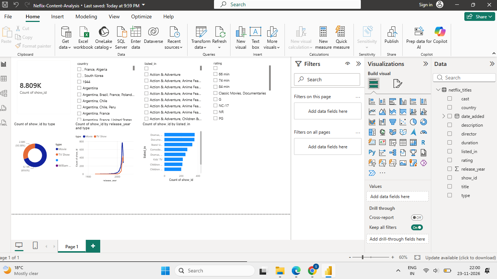

# Netflix Content Analysis (Power BI)

An interactive Power BI dashboard built using the Netflix Movies and TV Shows dataset from Kaggle to explore content distribution, yearly trends, and top genres.

## Dashboard Preview

## Key Features & Visuals
- Interactive Slicers: Filter content by Country, Release Year, Genre (listed_in), and Rating.
- Movies vs TV Shows: Donut chart comparing movies and TV shows.
- Content Growth by Year: Line chart tracking release trends over time.
- Top Genres: Bar chart showing top genres by title count.

## Dataset
- Source: Kaggle – Netflix Movies and TV Shows (netflix_titles.csv)# netflix-content-analysis-powerbi
